# NES para ESP32-S3 4848S040

Emulador de NES ([Nofrendo](components/nofrendo/AUTHORS)) sobre **ESP-IDF v6.1** para la placa
**Guition ESP32-4848S040**: pantalla táctil de 4" 480×480, microSD y bocina integrada.
Incluye controles táctiles en pantalla, **Zapper táctil** (Duck Hunt y similares) y audio por I2S.

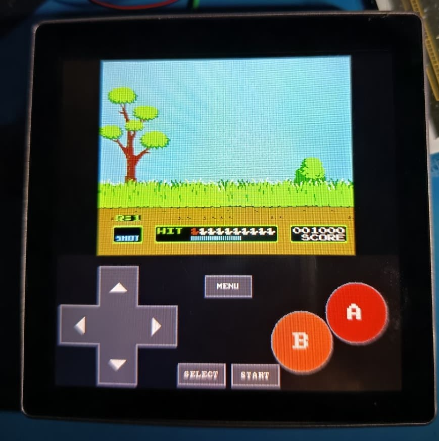

> **No incluye ROMs ni apoya la piratería.** Este proyecto no contiene juegos y no se creó para copiarlos ni
> distribuirlos de forma ilegal. Usa solo copias de seguridad de cartuchos que poseas legítimamente. Nintendo y
> los demás titulares conservan todos sus derechos; ver el [aviso legal](#aviso-legal) al final.

## Capturas

Fotos del dispositivo real, tomadas con un teléfono (de ahí algún reflejo).

| Menú de selección de juego | Duck Hunt: pantalla de título | Super Mario Bros. 3 (mapper MMC3) |
|---|---|---|
| 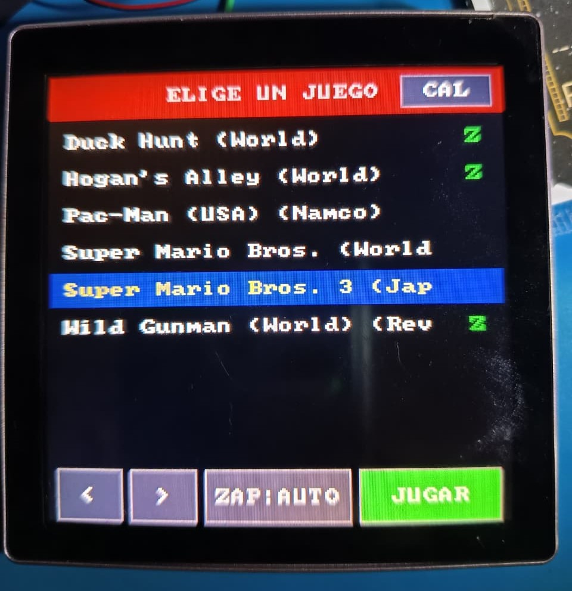 | 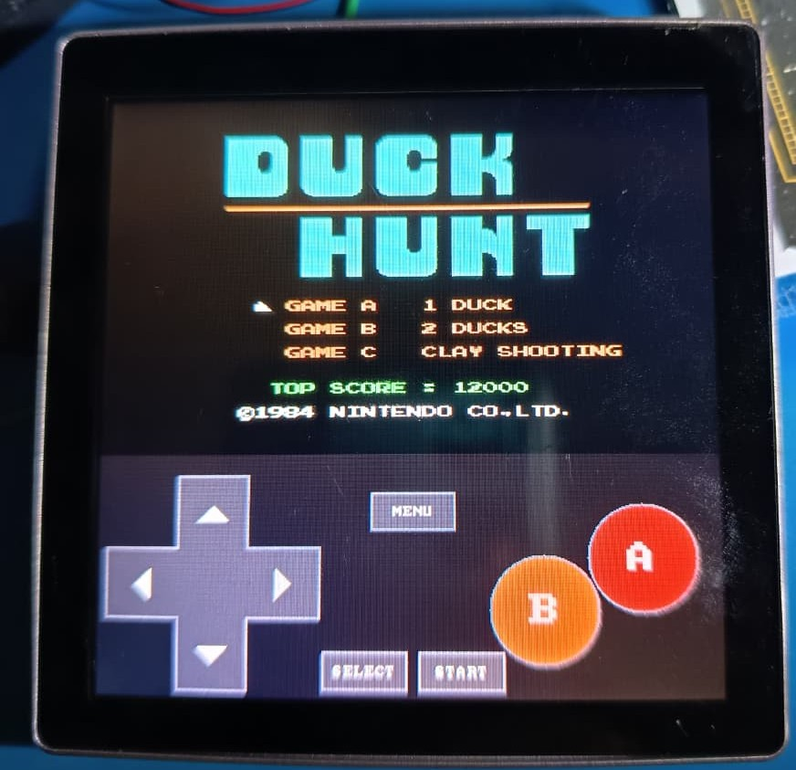 | 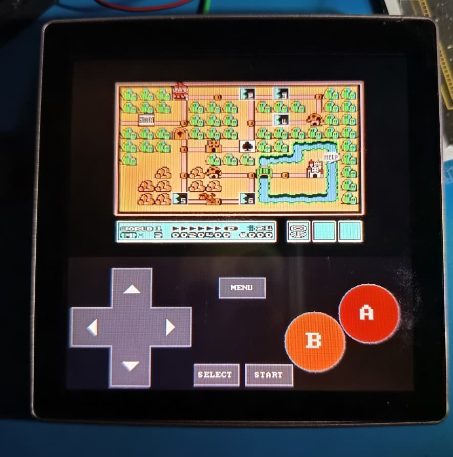 |

### Duck Hunt con el Zapper táctil

| Ronda 1 | El perro al inicio de la partida | Ronda 1 con 2 000 puntos |
|---|---|---|
|  | 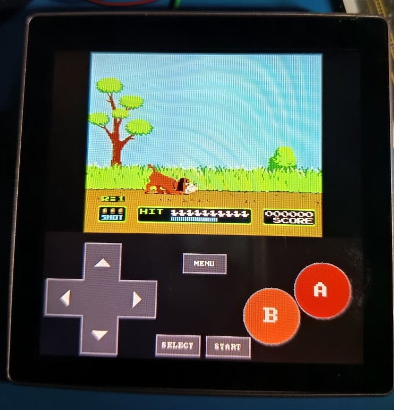 | 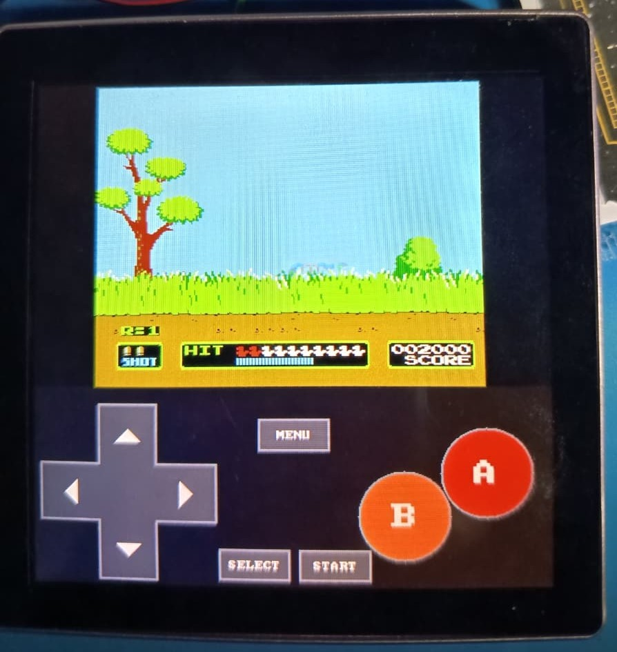 |

La imagen del juego ocupa la parte superior (360×288 px, recortada 8 columnas por lado) y los controles táctiles
la parte inferior: cruceta, `A`, `B`, `SELECT`, `START` y `MENU`.

### Más capturas (fotogramas de un video)

| Pantalla de juego | Controles táctiles en uso | Scroll del escenario | Vista general |
|---|---|---|---|
| 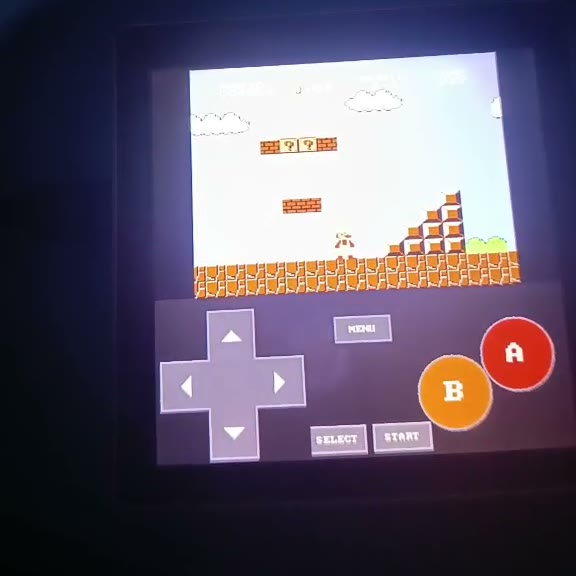 | 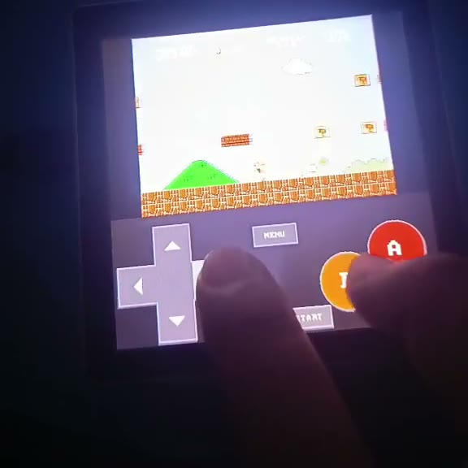 | 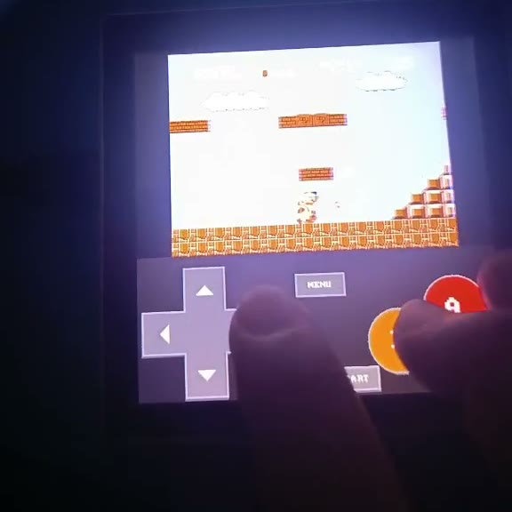 | 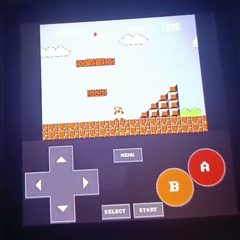 |

## Hardware

| Componente | Detalle |
|---|---|
| Módulo | ESP32-S3-WROOM-1 (16 MB flash, 8 MB PSRAM octal) |
| Pantalla | ST7701, 480×480, bus RGB de 16 bits (RGB565) |
| Táctil | GT911, I2C, hasta 5 puntos |
| Almacenamiento | microSD (SDMMC, 1 bit) |
| Audio | amplificador I2S mono (NS4168 según [LCD Wizard](https://lcdwizard.com/boards/guition-4848s040-speaker); el chip no es legible en la foto) en el conector `P7 Speak` |

### Fotos de la placa

| Conectores internos (H1, P7 Speak, BAT, microSD) | Vista lateral (USB-C y ranura TF) | Vista trasera (interfaces) |
|---|---|---|
|  | 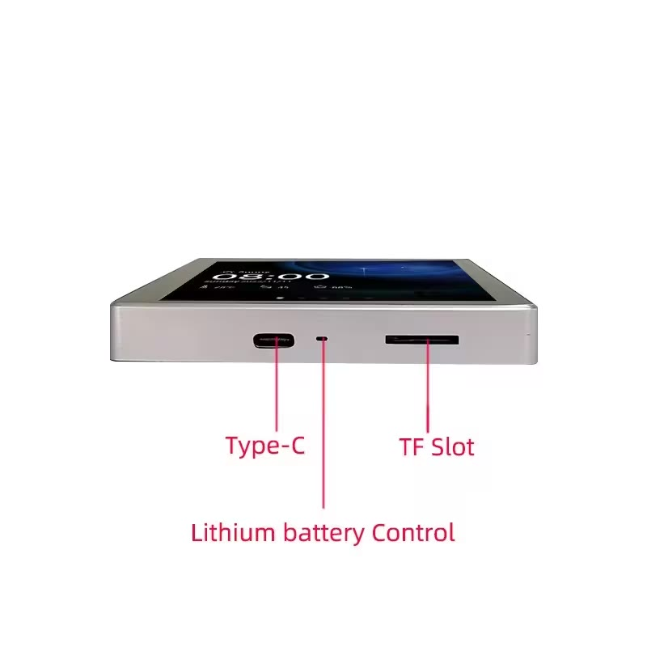 |  |

El conector de la bocina es un **MX1.25 de 2 pines** (`P7 Speak`). El conector `H1` expone `GPIO40`, `GPIO2` y
`GPIO1` (los pines de los relés y, según la configuración de resistencias, del audio), `RXD`, `TXD`, `5V` y `GND`.

Estas fotos son de terceros (fotos de producto del vendedor y una foto del conector con anotaciones). Pertenecen a
sus autores y se incluyen solo como referencia; sustitúyelas por fotos propias si vas a redistribuir el repositorio.

### Pines usados

| Función | GPIO |
|---|---|
| Retroiluminación | 38 |
| ST7701 (init por SPI de 3 hilos, por software) | CS 39, SCK 48, SDA 47 |
| Bus RGB | HSYNC 16, VSYNC 17, DE 18, PCLK 21, datos `4 5 6 7 15 8 20 3 46 9 10 11 12 13 14 0` |
| Táctil GT911 (I2C, dirección 0x5D) | SDA 19, SCL 45 |
| microSD (SDMMC, 1 bit) | CLK 48, CMD 47, D0 41 |
| Audio I2S | BCLK 1, LRCLK 2, DIN 40 |
| Consola serie (UART0, conector `P1` y `H1`) | TX 43, RX 44 |
| Relés (solo versión con relés) | 40, 2 y 1: **comparten pines con el audio** |
| Batería | conector `BAT` MX1.25 de 2 pines, sin GPIO |

Notas sobre el uso de pines:

- **GPIO 47 y 48 se comparten:** el firmware los usa por software para inicializar el ST7701 al arrancar y después
  son CMD y CLK de la microSD. La inicialización de la pantalla termina antes de montar la tarjeta.
- **Pines de arranque (*strapping*) del ESP32-S3 en uso:** GPIO0, 3 y 46 llevan datos del bus RGB y GPIO45 es el
  SCL del táctil. Así funciona la placa de fábrica; no los reasignes sin comprobar el arranque.
- **GPIO 43 y 44** son la consola serie (`idf.py monitor`); no los uses para otra cosa si quieres ver los logs.
- La búsqueda de D0 de la tarjeta prueba además 42, 40, 2, 1 y 39 si el 41 falla, pero omite los pines del audio.

Los pines de audio (1, 2 y 40) son los mismos que usan los relés de la versión con relés. Según
[LCD Wizard](https://lcdwizard.com/boards/guition-4848s040-speaker), tres resistencias de 0 Ω junto al
amplificador deciden a cuál van: **R21, R22, R23** a la bocina o **R25, R26, R27** a los relés. Si tu placa
trae las resistencias en R25–R27, no sonará hasta que las muevas a R21–R23. No lo he verificado en todas
las revisiones de la placa.

## Mapa de memoria del dispositivo

### Qué significa «N16R8»

El módulo de la placa es un **ESP32-S3-WROOM-1-N16R8**. El sufijo describe la memoria externa que lleva:

| Código | Significado | En esta placa |
|---|---|---|
| **N16** | Flash SPI de **16 MB** (donde viven el programa, la ROM y la configuración) | 16 MB, modo DIO a 80 MHz |
| **R8** | **8 MB de PSRAM octal** (RAM externa, de 8 bits de bus) | 8 MB a 80 MHz |

Es decir, además de la RAM que trae el propio chip, hay 8 MB de RAM extra, pero **no es igual de rápida**. La
diferencia entre las dos es lo que más pesa en el rendimiento del emulador. Ojo: otras variantes (por ejemplo
`N8` o `N16R2`) tienen menos flash o menos PSRAM y este proyecto necesita los 8 MB de PSRAM.

### Resumen

| Memoria | Tamaño | Velocidad real medida | Para qué se usa aquí |
|---|---|---|---|
| **RAM interna (SRAM)** | 512 KB en el chip (~266 KB libres para el *heap*) | ~360 MB/s al copiar el cuadro | Código caliente del emulador, bitmap del cuadro, anillo de audio, pilas de las tareas |
| **PSRAM octal** | 8 MB externos | ~48 MB/s al copiar el cuadro (unas 7 veces más lenta) | ROM, lienzo de la interfaz, copias del cuadro |
| **Flash** | 16 MB externos | Se lee por una caché de 16 KB (instrucciones) | Programa, ROM instalada, ajustes |

La PSRAM no se lee directamente: pasa por la caché de datos del chip. Un acceso que no está en la caché espera,
y una escritura grande se hace por ráfagas. Por eso conviene que **lo que se toca en cada línea o cada cuadro
esté en RAM interna** y que la PSRAM guarde lo grande o lo que se lee de forma secuencial.

### Diagrama de bloques de las memorias

Todas las memorias, de la más lenta a la más rápida, y qué guarda cada una:

```
LENTA                                                                                                               RAPIDA
┌───────────────────────────┐  ┌───────────────────────────┐  ┌───────────────────────────┐  ┌───────────────────────────┐
│ microSD                   │  │ FLASH                     │  │ PSRAM                     │  │ RAM INTERNA               │
│ ~7.5 GB, SDMMC 1 bit      │  │ 16 MB, DIO 80 MHz         │  │ 8 MB, octal 80 MHz        │  │ 512 KB, la mas rapida     │
├───────────────────────────┤  ├───────────────────────────┤  ├───────────────────────────┤  ├───────────────────────────┤
│ Archivos .nes             │─►│ factory   firmware        │─►│ ROM en uso (PRG+CHR)      │─►│ IRAM  CPU+PPU+APU 46 KB   │
│ (biblioteca de            │  │           1 MB (450 KB)   │  │           hasta 1 MB      │  │ Bitmap del cuadro  60 KB  │
│ juegos)                   │  │ nesgame   ROM en uso      │  │ Lienzo interfaz 450 KB    │  │ Bounce buffers    ~38 KB  │
│                           │  │           1 MB (max.)     │  │ 3 copias cuadro 180 KB    │  │ Anillo de audio    8 KB   │
│ Se lee solo al            │  │ nvs       ajustes 24 KB   │  │ libre     ~6.4 MB         │  │ Caches 16 KB + 64 KB      │
│ elegir un juego           │  │ libre     ~13.9 MB        │  │                           │  │ RAM del NES 2 KB, VRAM    │
└───────────────────────────┘  └───────────────────────────┘  └───────────────────────────┘  └───────────────────────────┘
```

La **ROM** (`nesgame`) pasa por tres lugares: la microSD, la flash y la PSRAM. En la flash queda guardada entre
reinicios, y al arrancar el emulador se copia a PSRAM, que es de donde la leen la CPU y la PPU. La **RAM** del
NES original (2 KB) y su memoria de vídeo viven en RAM interna, dentro de las estructuras del emulador.

Y el camino de un cuadro, de la emulación al panel:

```
 ROM (PSRAM) ──caché──► CPU 6502 + PPU  ──dibuja──►  bitmap 256×240   (RAM interna)
 (PRG + CHR)           (IRAM, núcleo 1)                     │
                                                            │ copia (~1 ms)
                                                            ▼
                                       3 copias del cuadro (PSRAM) ── la más reciente
                                                            │
        Lienzo de la interfaz (PSRAM) ──┐                   │ la interrupción del panel
                                        ├───► tira de 20 filas con paleta y escalado 1.5×
                                        ┘                   │ (bounce buffer, RAM interna)
                                                            ▼
                                                    DMA ──► panel 480×480
```

### Flash (16 MB)

| Dirección | Tamaño | Contenido |
|---|---|---|
| `0x0000` | 32 KB | Bootloader |
| `0x8000` | 4 KB | Tabla de particiones |
| `0x9000` | 24 KB | `nvs`: ajustes (calibración del táctil, último juego, modo Zapper por juego) |
| `0xF000` | 4 KB | `phy_init` |
| `0x10000` | 1 MB | `factory`: el programa (la imagen actual ocupa unos 450 KB) |
| `0x110000` | 1 MB | `nesgame`: la ROM instalada (máximo 1 MB) |
| `0x210000` en adelante | ~13.9 MB | Libre |

Diagrama de secciones (las alturas **no** están a escala: el bloque libre es mucho mayor que el resto):

```
 Dirección      Flash SPI de 16 MB (0x000000 - 0xFFFFFF)
 ─────────────  ─────────────────────────────────────────────────────
 0x000000  ┌──────────────────────────────────────────────┐
           │ Bootloader                          32 KB    │  arranca el chip
 0x008000  ├──────────────────────────────────────────────┤
           │ Tabla de particiones                 4 KB    │  lista de estas secciones
 0x009000  ├──────────────────────────────────────────────┤
           │ nvs                                 24 KB    │  ajustes: calibración, último
           │                                              │  juego, modo Zapper por juego
 0x00F000  ├──────────────────────────────────────────────┤
           │ phy_init                             4 KB    │  calibración de radio (sin uso)
 0x010000  ├──────────────────────────────────────────────┤
           │ factory  (programa)                  1 MB    │  el firmware: ~450 KB usados
           │ ████████████████████░░░░░░░░░░░░░░░░░░░░░░░░ │  (44 % de la partición)
 0x110000  ├──────────────────────────────────────────────┤
           │ nesgame  (ROM)                       1 MB    │  el juego instalado, máx. 1 MB
           │ █░░░░░░░░░░░░░░░░░░░░░░░░░░░░░░░░░░░░░░░░░░░ │  (p. ej. SMB: 80 KB)
 0x210000  ├──────────────────────────────────────────────┤
           │                                              │
           │ Libre                            ~13.9 MB    │  sin usar
           │                                              │
 0xFFFFFF  └──────────────────────────────────────────────┘
```

Cómo se usa cada sección:

- **Bootloader y tabla de particiones:** el chip los lee al encender; con la tabla encuentra el programa.
- **`factory`:** se graba con `idf.py flash`. Es el firmware completo.
- **`nesgame`:** la ROM en uso. Con `idf.py flash` se graba `rom/game.nes`; desde el menú, al elegir un juego de
  la microSD, se copia aquí (solo si es distinto de lo que ya hay). Al arrancar el emulador se copia a PSRAM.
- **`nvs`:** pares clave-valor que sobreviven a reinicios. `idf.py erase-flash` lo borra junto con toda la flash (hay que recalibrar el táctil).

### Mapa funcional de la flash

La flash no es memoria de trabajo: el procesador no la lee directamente. Esta sección explica **cómo arranca el
chip desde ella, cómo llega su contenido al procesador y qué hay dentro del programa**.

#### 1. Secuencia de arranque

```
 Encendido o reinicio
    │
    ▼
 ① ROM del chip (grabada de fábrica, no se puede borrar)
    │  lee los pines de arranque (strapping) y carga el segundo cargador desde la dirección 0x0000
    ▼
 ② Bootloader de ESP-IDF (flash 0x0000, 32 KB)
    │  lee la tabla de particiones en 0x8000 → encuentra la partición «factory» (0x10000)
    │  comprueba la imagen y copia a RAM los segmentos que deben vivir allí (IRAM, DRAM, RTC)
    │  configura el MMU: enlaza las páginas de flash con el espacio de direcciones del procesador
    ▼
 ③ Arranque del sistema (en la partición «factory»)
    │  inicia la PSRAM, el heap y los dos núcleos
    ▼
 ④ app_main (main/main.c)
       calibra el táctil → menú de ROMs → copia la ROM de «nesgame» a PSRAM → inicia el emulador
```

#### 2. Cómo llega la flash al procesador

La flash vive fuera del chip y **se accede por tres caminos distintos**:

```
                       ┌────────────────────────────── Caché ─────────────────────────────┐
  Núcleos (240 MHz)    │                                                                  │     Flash 16 MB
 ┌──────────────┐      │  instrucciones  16 KB ◄── MMU, páginas de 64 KB ──┐              │   ┌──────────────┐
 │ ejecutar     │◄─────┤  (IROM, 0x4200_0000…)                              ├─────────────┼──►│ código       │ 252 KB
 │ código       │      │                                                    │             │   ├──────────────┤
 ├──────────────┤      │  datos  64 KB      ◄── MMU, páginas de 64 KB ──────┘             │   │ datos const. │  80 KB
 │ leer         │◄─────┤  (DROM, 0x3C00_0000…)                                            │   ├──────────────┤
 │ constantes   │      └──────────────────────────────────────────────────────────────────┘   │ ROM «nesgame»│  1 MB
 └──────────────┘                                                                             │ NVS, tabla…  │
 ┌──────────────┐   API del driver de flash (esp_partition_read / write / erase),               └──────┬───────┘
 │ ROM del juego│◄── sin pasar por el MMU ─────────────────────────────────────────────────────────┘
 │ y ajustes    │
 └──────────────┘
```

- **Ejecutar en el sitio (XIP):** el código que no está en IRAM se ejecuta leyéndolo de la flash a través de la caché
  de instrucciones. Cada fallo de caché cuesta una lectura de flash.
- **Constantes (`.rodata`):** tablas, cadenas y datos de solo lectura se leen por la caché de datos.
- **Particiones por API:** la ROM instalada y los ajustes (NVS) no se mapean; se leen, escriben y borran con
  llamadas del driver. Escribir o borrar suspende la caché mientras dura la operación, así que el código que está
  en la flash se detiene (por eso el código del emulador está en IRAM y por eso la imagen puede parpadear si se
  instala una ROM, y probablemente también al leer la PSRAM, que pasa por la misma caché).
- **Compartido con la PSRAM:** la ventana de datos (`0x3C00_0000…`) la usan tanto la flash como la PSRAM. Las
  direcciones `0x3C…` que vemos en el log (por ejemplo la ROM copiada a PSRAM) salen de esa ventana.

| Región del procesador | Direcciones | Qué contiene |
|---|---|---|
| IROM (instrucciones desde flash) | `0x4200_0000` en adelante | Código en flash |
| DROM / PSRAM (datos externos) | `0x3C00_0000` en adelante | Constantes de la flash y PSRAM |
| IRAM (instrucciones en RAM) | `0x4037_0000` en adelante | Código caliente y vectores de interrupción |
| DRAM (datos en RAM) | `0x3FC8_8000` en adelante | `.data`, `.bss`, heap, pilas |
| RTC | `0x600F_E000` | Memoria que sobrevive al sueño (casi sin usar aquí) |

*Las direcciones salen del manual técnico del ESP32-S3; las de DRAM, RTC y PSRAM coinciden con las que muestra el
log de arranque.*

#### 3. Qué hay dentro de la imagen del programa

La imagen de la partición `factory` mide **460 374 bytes (~450 KB, el 44 % de 1 MB)**. Medido con `idf.py size`:

| Segmento | Dónde acaba | Tamaño | % de la imagen | Función |
|---|---|---|---|---|
| Código en flash (`.text`) | se ejecuta en la flash (IROM) | 251 920 B | 54.7 % | El sistema, los controladores, el menú, el resto del emulador |
| Datos de solo lectura (`.rodata`) | se lee de la flash (DROM) | 81 728 B | 17.8 % | Tablas del emulador, cadenas, la fuente de texto |
| Código en RAM (IRAM + DIRAM `.text`) | **se copia a RAM al arrancar** | 106 983 B | 23.2 % | CPU 6502, PPU y APU de Nofrendo (~46 KB), vectores y rutinas que no pueden esperar a la flash |
| Datos inicializados (`.data`) | **se copia a RAM al arrancar** | 19 707 B | 4.3 % | Variables con valor inicial |
| RTC | se copia a RAM RTC | 60 B | ~0 % | Casi sin usar |
| `.bss` (no ocupa flash) | se pone a cero en RAM | 34 592 B | — | Variables sin valor inicial |

Lo que importa de esta tabla:

- Solo el **~28 %** de la imagen (código caliente y datos) se copia a RAM al arrancar; el otro **~72 %** se queda en
  la flash y se lee por la caché.
- Por eso mover el 6502, la PPU y la APU a IRAM fue tan efectivo: son los ~46 KB que más se ejecutan y con la
  caché de instrucciones de 16 KB se expulsaban constantemente.
- Tras la copia, el procesador no vuelve a leer ese ~28 % de la flash: solo lee de ella el código poco usado y las
  constantes.
- Quedan **~588 KB libres** en la partición `factory`, y ~13.9 MB sin particionar en la flash.

### RAM interna (SRAM, 512 KB)

| Uso | Tamaño aprox. | Notas |
|---|---|---|
| Código del emulador en IRAM | ~46 KB | CPU 6502, PPU y APU de Nofrendo (`components/nofrendo/linker.lf`). Fuera de la IRAM la caché de instrucciones de 16 KB fallaba mucho |
| Cachés de instrucciones y de datos | 16 KB + 64 KB | Reservadas por el chip para leer flash y PSRAM |
| Bitmap del emulador | 60 KB | 256×240 bytes donde dibuja la PPU. **Tiene que estar aquí** (ver abajo) |
| Anillo de audio | 8 KB | 4096 muestras de 16 bits |
| *Bounce buffers* del panel | ~38 KB | Dos tiras de 20 filas (480×20 px) que lee el DMA del panel |
| Resto del *heap* | lo que sobra | Pilas de tareas, SD/FAT, I2C, I2S, etc. |

### PSRAM (8 MB)

| Uso | Tamaño | Notas |
|---|---|---|
| ROM del juego | hasta 1 MB | Se copia desde la flash al arrancar; la CPU y la PPU la leen por la caché |
| Lienzo de la interfaz | 450 KB | 480×480 en RGB565: botones, menú y marcos |
| Copias del cuadro | 3 × 60 KB | Tres copias de 256×240 (la CPU publica la más reciente; la interrupción del panel lee la última) |
| Libre | ~6.4 MB | Margen para futuras mejoras |

El panel **no tiene framebuffer**: una interrupción genera cada tira de 20 filas al vuelo, leyendo del cuadro y del
lienzo, y precarga la caché con lo que leerá la siguiente tira. Así se ahorran ~1.4 MB de PSRAM y unos 7.5 ms por
cuadro de volcado.

### Qué implica en el rendimiento (lecciones medidas)

- **El bitmap del emulador debe estar en RAM interna.** Si por cualquier razón cae a PSRAM (por ejemplo porque otra
  reserva interna se hizo antes), la PPU y la copia se vuelven mucho más lentas. Hay que dejarle sitio antes de
  reservar otros búferes internos.
- **Copiar el cuadro a RAM interna** (probado antes de quitar los framebuffers) bajó la copia de 1.27 ms a 0.17 ms por
  cuadro; hoy las copias están en PSRAM (~1 ms por cuadro), así que es una mejora pendiente.
- **El código del emulador en IRAM** bajó la CPU de 6.5–7.5 ms a unos 2 ms por cuadro.
- **Escribir en la PSRAM es lento** (unos 28–50 MB/s) y compite con el panel, que también la lee. Por eso se
  evitaron los volcados grandes.
- **Con 8 MB de PSRAM sobra espacio, pero no ancho de banda**: lo escaso es el tiempo de acceso, no los megabytes.

## Lo que descubrimos de la placa 4848S040

Resumen de lo que aprendimos sobre cómo está hecha la placa y cómo se comporta su memoria. Cada dato indica si lo
**medimos** nosotros, lo **probamos** en la placa o lo tomamos de una **fuente externa**.

### Estructura: qué conecta con qué

```
 ESP32-S3-WROOM-1 (N16R8)
  │
  ├── RGB de 16 bits (HSYNC 16, VSYNC 17, DE 18, PCLK 21, 16 datos) ────────► Panel ST7701 480×480
  ├── SPI de 3 hilos por software (CS 39, SCK 48, SDA 47), solo al arrancar ► configura el ST7701
  ├── GPIO 38 ──────────────────────────────────────────────────────────────► Luz de fondo
  ├── I2C (SDA 19, SCL 45) ─────────────────────────────────────────────────► Táctil GT911 (0x5D)
  ├── SDMMC de 1 bit (CLK 48, CMD 47, D0 41) ───────────────────────────────► microSD
  ├── I2S (BCK 1, LRCK 2, DIN 40) ──► amplificador ──┬─ R21–R23 ──► P7 Speak (bocina)
  │                                                  └─ R25–R27 ──► relés (los mismos GPIO 40, 2, 1)
  ├── UART0 (TX 43, RX 44) ──► CH340 ──► USB-C (consola y grabación)
  └── Flash y PSRAM octal (GPIO 35–37): dentro del módulo, no se pueden usar para otra cosa
```

### Descubrimientos sobre pines y periféricos

1. **Tres pines hacen doble trabajo en el audio.** GPIO 1, 2 y 40 son el I2S y, en la versión con relés, los tres
   relés. Cuál de los dos usos queda conectado depende de las resistencias de 0 Ω R21–R23 (bocina) o R25–R27 (relés).
   *Fuente externa* ([LCD Wizard](https://lcdwizard.com/boards/guition-4848s040-speaker) y la configuración de
   [esphome-modular-lvgl-buttons](https://github.com/agillis/esphome-modular-lvgl-buttons), que define los relés en
   GPIO 40, 2 y 1). El audio **no está confirmado** en esta placa; ver el
   [issue #11](https://github.com/yetto-tools/NES-ESP32-4848S040/issues/11). El menú tiene un botón **SND** que
   reproduce un tono de prueba de 440 Hz.
2. **GPIO 47 y 48 se reutilizan.** Primero configuran el ST7701 y después son CMD y CLK de la microSD. *Probado.*
3. **La microSD funciona con una sola línea de datos (D0 = GPIO 41).** Se encontró probando candidatos
   (41, 42, 40, 2, 1, 39). D1, D2 y D3 se dejan con *pull-up*: si D3 queda en bajo al iniciar, la tarjeta entra en
   modo SPI y no monta. *Probado.*
4. **El táctil GT911 manda tramas vacías con el dedo puesto.** Por eso el firmware solo suelta un botón tras 40 ms
   sin puntos. Con 120 ms se perdían los toques repetidos rápidos. *Medido y probado.*
5. **Reloj de píxel:** aquí se usa 16 MHz con el panel sin framebuffer. La configuración de ESPHome para esta
   placa usa 6 MHz. *Fuente externa; el nuestro funciona con margen (la tira más lenta tarda ~350 µs de ~650 µs).*
6. **El panel refresca a ~60.8 Hz y el emulador corre a 60.0 Hz.** Las dos fases derivan; es la causa probable de
   un resto de latencia de entrada. *Medido.*

### Descubrimientos sobre la memoria

1. **La PSRAM es unas 7 veces más lenta que la RAM interna** al copiar un cuadro de 60 KB: ~1.27 ms a PSRAM frente
   a ~0.17 ms entre RAM internas. *Medido.*
2. **El bitmap donde dibuja la PPU tiene que estar en RAM interna.** Si cae a PSRAM, la PPU pasa de ~3.3 a ~4 ms
   y la copia se vuelve más lenta. Pasó cuando una reserva interna se hizo antes de crear el bitmap, y se detectó
   comprobando la dirección del búfer (`0x3C…` es PSRAM, `0x3FC…` es RAM interna). *Medido.*
3. **El código del emulador debe ejecutarse desde IRAM.** La caché de instrucciones es de solo 16 KB y el 6502, la
   PPU y la APU suman ~46 KB: fuera de la IRAM la CPU gastaba 6.5–7.5 ms por cuadro y con ella unos 2 ms. *Medido.*
4. **Quitar el *bounce buffer* corrompe la imagen.** La causa no está confirmada.
   Sí funciona generar cada tira de 20 filas en una interrupción y **precargar la caché** con lo que leerá la
   siguiente tira. Con eso no hacen falta framebuffers en PSRAM (se liberan ~1.4 MB) y se ahorran ~7.5 ms por cuadro de
   volcado. *Probado y medido.*
5. **Sin precarga de caché, las ROM grandes desplazaban la imagen.** Con mapper 0 (Super Mario Bros) se veía bien y
   con MMC3 (Super Mario Bros 3) se corrompía, probablemente por contención en el bus de la PSRAM. La precarga lo
   resolvió.
   *Probado.*
6. **Sobra espacio, no ancho de banda.** De los 8 MB de PSRAM quedan ~6.4 MB libres, pero lo que limita es el tiempo de
   acceso. *Medido.*
7. **Escribir en la flash puede interrumpir la imagen unos instantes**, probablemente porque la caché de
   instrucciones espera mientras la flash está ocupada. *Observado.*

### Notas de desarrollo en este equipo

- El puerto serie USB (CH340) cambia de número al mover el cable (por ejemplo COM12 y COM8), y abrirlo puede
  **reiniciar la placa**. Para capturar el log de un juego hay que iniciar la captura antes de abrirlo desde el menú.
- Los logs se emiten cada 5 s: `video:` (cuadros por segundo y la interrupción del panel) y `emu:` (ms por cuadro).

## Compilar y grabar

Requisitos: ESP-IDF v6.1 instalado y exportado en la terminal.

```powershell
idf.py set-target esp32s3        # solo la primera vez
idf.py build
idf.py -p COM12 flash            # ajusta el puerto
idf.py -p COM12 monitor
```

`idf.py flash` graba también `rom/game.nes` en la partición `nesgame` (0x110000). Esa ROM no está en el
repositorio: pon la tuya en `rom/game.nes` antes de grabar, o usa la microSD (ver más abajo).

Si `idf.py` se queja de que el directorio `build/` se configuró con otro entorno de Python, compila en otro
directorio con `idf.py -B <carpeta> build`, o borra `build/`.

### Particiones (`partitions.csv`)

| Nombre | Tipo | Offset | Tamaño |
|---|---|---|---|
| nvs | data | 0x9000 | 24 KB |
| phy_init | data | 0xf000 | 4 KB |
| factory | app | 0x10000 | 1 MB |
| nesgame | 0x40 / 0x01 | 0x110000 | 1 MB (ROM, máximo 1 MB) |

## Uso

### Elegir juego (microSD)

Si hay tarjeta, al arrancar aparece el menú **ELIGE UN JUEGO** con los `.nes` de `/`, `/nes` y `/roms`.
Toca un juego (o `JUGAR`) y se copia a la partición `nesgame`; si ya estaba grabado igual, no se vuelve a
escribir. Sin tarjeta o sin archivos `.nes`, arranca el juego que ya está en la flash.

| Botón del menú | Acción |
|---|---|
| `<` / `>` | página anterior / siguiente |
| `ZAP:AUTO/SI/NO` | modo Zapper del juego seleccionado |
| `JUGAR` | copia la ROM y arranca |
| `CAL` (barra roja) | recalibrar el táctil |

Una **Z** verde junto al nombre indica que el juego usa el Zapper.

### Controles en el juego

Cruceta, `A`, `B`, `SELECT` y `START` en pantalla. Con un toque corto en `MENU` se reinicia y se vuelve a la
selección de juego.

| Combinación | Efecto |
|---|---|
| Start + Select + A + B | reinicio del juego |
| Select + Start (1 s) | reinicio del equipo |

### Calibración del táctil

Se calibra la primera vez con 4 cruces y se guarda en la memoria no volátil. Para repetirla, enciende la placa
con un dedo en la pantalla o usa `CAL` en el menú de juegos.

### Zapper táctil

Tocar el área de juego equivale a disparar la pistola en ese punto.

- **Por juego:** `AUTO` lo activa por el nombre del archivo (Duck Hunt, Hogan's Alley, Wild Gunman, Gumshoe,
  Operation Wolf…). Si no lo detecta, pon `ZAP:SI`. Se guarda por juego.
- **Gatillo:** se pulsa 6 cuadros por toque.
- **Sensor de luz:** sigue apuntando al punto tocado ~0.75 s y solo ve luz casi blanca (luminancia ≥ 220) en un
  radio de 10 px NES. Duck Hunt decide el acierto con un cuadro negro y otro con cajas blancas, unos 10 cuadros
  después del toque.
- **Mira roja:** se dibuja donde el sistema cree que disparaste.
- Constantes ajustables en `main/video_audio.c` (`ZAP_*`).

### Audio

I2S a 22 050 Hz, el canal se duplica a estéreo. El emulador deja las muestras en un anillo y una tarea propia
las manda al I2S. El volumen se ajusta en `idf.py menuconfig` → *NES ESP32-S3 – Audio* (`AUDIO_VOLUME`, 0–400 %).

## Arquitectura

```
main/
  main.c          arranque, calibración, menú, copia de la ROM a PSRAM
  menu.c          menú táctil de ROMs desde la microSD
  gamepad.c       táctil GT911, botones en pantalla y calibración
  lcd_rgb.c       ST7701 + bus RGB, triple buffer y dibujo del juego
  ui.c            controles dibujados en el lienzo de la interfaz
  video_audio.c   capa OSD de Nofrendo: video, audio, entrada, Zapper
  zapper.c        modo Zapper por juego (detección por nombre, NVS)
components/nofrendo/   emulador (código de 2001, modificado)
```

- **Núcleos:** el emulador corre solo en el núcleo 1. Panel, vídeo, audio y táctil corren en el núcleo 0
  (el táctil con prioridad 7 para que el vídeo no lo deje sin CPU).
- **Vídeo:** el emulador copia cada cuadro (256×240) a una de tres copias privadas y publica la más reciente. El
  panel RGB **no tiene framebuffer**: una interrupción construye cada tira de 20 filas al vuelo (paleta, escalado
  1.5× con 8 columnas recortadas por lado, como el overscan de una tele: imagen de 360×288) y copia el resto del
  lienzo de la interfaz. Cambia de cuadro solo al inicio del suyo, sin *tearing*. Reloj de píxel de 16 MHz
  (`LCD_PCLK_HZ` en `lcd_rgb.c`).
- **Entrada:** se lee justo antes del vblank (línea 241), que es cuando el juego la consulta.
- **Reloj del emulador:** `esp_timer` a 60 Hz exactos.

## Rendimiento y limitaciones conocidas

- El emulador va a **60 cuadros/s sin cuadros saltados** y el panel a ~60.8 fps. Con Super Mario Bros usa unos
  5 ms de los 16.7 ms del cuadro (CPU ~1.7, PPU ~3.3, APU ~0.4) y con Super Mario Bros 3 unos 5.8 ms.
- La interrupción del panel cuesta ~2.9 ms por cuadro; la tira de 20 filas más lenta tarda ~350 µs de un
  presupuesto de ~650 µs.
- Cada 5 s el monitor serie muestra cuadros/s del emulador y del panel, el tiempo de la interrupción, la tira más
  lenta, el reparto de ms por cuadro (CPU, PPU, mapper, APU, copia) y el audio perdido.
- Super Mario Bros 3 (mapper MMC3) y el scroll rápido son los casos más exigentes.
- Mappers soportados: los de Nofrendo (0–5, 7–9, 11, 15, 16, 18, 19, 24, 32–34, 40–42, 46, 50, 64–66, 70, 73,
  75, 78, 79, 85, 87, 93, 94, 99, 160, 229, 231 y VRC).
- Escribir en la flash (copiar una ROM de la SD) puede interrumpir la imagen unos instantes.

## Base del emulador y enlaces

- **Emulador original: Nofrendo**, de Matthew Conte (© 1998–2000). No encontré un repositorio oficial del
  autor; el desarrollo original está documentado en esta
  [página de historia del emulador](https://lngn.net/archaic-ruins/emulator/nes/nofrendo.htm).
- **Port a ESP32 en el que se basa `components/nofrendo`:**
  [espressif/esp32-nesemu](https://github.com/espressif/esp32-nesemu), una prueba de concepto de Espressif que
  adapta Nofrendo como componente de ESP-IDF. Según su documentación no incluye sonido y no recibe más
  desarrollo. Hay más contexto en el
  [hilo del foro de esp32.com](https://esp32.com/viewtopic.php?p=3965).
  El archivo [`components/nofrendo/AUTHORS`](components/nofrendo/AUTHORS) atribuye esa adaptación a
  Jeroen Domburg (Espressif).
- No he comparado este código línea por línea con el de Espressif; la relación se deduce del `AUTHORS` y de los
  comentarios del propio código.

### Qué se añadió o cambió respecto a esa base

- Salida de **audio I2S** hacia la bocina de la placa, en una tarea propia.
- **Pantalla** ST7701 480×480 con triple búfer, imagen recortada 360×288 y controles táctiles en pantalla.
- **Táctil** GT911 con calibración, **Zapper táctil** y modo Zapper por juego.
- **Menú de ROMs** desde la microSD, con copia a la partición `nesgame`.
- Reloj del emulador a 60 Hz exactos, copia de cada cuadro, ROM en PSRAM y reparto del trabajo entre los dos
  núcleos.

## Aviso legal

- **Sin afiliación:** este es un proyecto personal y educativo (curso Arquitectura II, UMG). **No está afiliado,
  patrocinado, autorizado ni respaldado por Nintendo** ni por ningún otro fabricante o editor de videojuegos.
- **Marcas y derechos de terceros:** *Nintendo*, *Nintendo Entertainment System*, *NES*, *Famicom*, *Zapper*,
  *Super Mario Bros.*, *Duck Hunt*, *Hogan's Alley*, *Wild Gunman* y los demás nombres, personajes, imágenes y
  juegos que se mencionan o aparecen en capturas son marcas registradas y obras protegidas por derechos de autor
  de **Nintendo** o de sus respectivos titulares. **Todos los derechos reservados a sus propietarios.** Se citan
  únicamente para identificar la consola y los juegos con los que es compatible el emulador.
- **Sin piratería:** no apoyamos, fomentamos ni toleramos la piratería de software de ninguna manera. El repositorio
  **no incluye ROMs, BIOS ni material con derechos de autor** y `.gitignore` excluye los archivos `*.nes`. No
  pidas ni compartas ROMs en los issues, pull requests ni en ningún otro lugar de este proyecto.
- **Uso responsable:** usa el emulador solo con copias de seguridad que hayas hecho tú mismo de cartuchos que posees
  legítimamente, o con juegos homebrew y de dominio público. Las leyes sobre copias de seguridad cambian según el
  país; cumplir con la ley de tu jurisdicción es tu responsabilidad. Esto no es asesoría legal.
- **Capturas e imágenes:** las fotos de `docs/` (`duck-hunt-*.jpg`, `smb3-mapa.jpg`, `menu-elegir-juego.jpg`,
  `ejemplo-*.jpg` y `dispositivo.jpg`) muestran juegos comerciales (Duck Hunt, Super Mario Bros., Super Mario Bros. 3,
  entre otros) en pantalla solo como ilustración del funcionamiento. Las fotos de la placa son de terceros (ver la
  sección de hardware).
- **Sin garantía:** el software se ofrece "tal cual", sin garantía de ningún tipo, bajo los términos de la licencia.
- **Retirada de contenido:** si eres titular de derechos y consideras que algún contenido de este repositorio
  infringe tus derechos, abre un issue y se retirará.

## Licencia

Todo el repositorio se distribuye bajo la **GNU Library General Public License, versión 2** (LGPL 2.0), la misma
licencia del emulador. El texto completo está en [`LICENSE`](LICENSE).

- **Nofrendo** © 1998–2000 Matthew Conte: sus cabeceras de código lo licencian bajo esa licencia ("version 2 of the
  GNU Library General Public License") y exigen conservar la leyenda en toda reproducción. Mis modificaciones a los
  archivos de `components/nofrendo/` quedan bajo la misma licencia.
- **Código propio** (`main/`, etc.): © 2026 los autores de este repositorio, bajo la misma licencia.
- **Discrepancia a tener en cuenta:** el README de Espressif describe el componente Nofrendo como GPLv2, mientras
  que las cabeceras dicen "Library" GPL. Elegí la de las cabeceras. La LGPL 2.0 permite además pasar a la GPL
  (sección 3), así que cambiar a GPLv2 sería compatible si más adelante lo prefieres.
- Si reutilizas código del repositorio de Espressif que esté fuera de Nofrendo, su README lo indica bajo
  Apache License 2.0. No he comprobado si este repositorio contiene alguno.
- Las capturas de `docs/` muestran juegos comerciales en pantalla; el repositorio no incluye ROMs.
