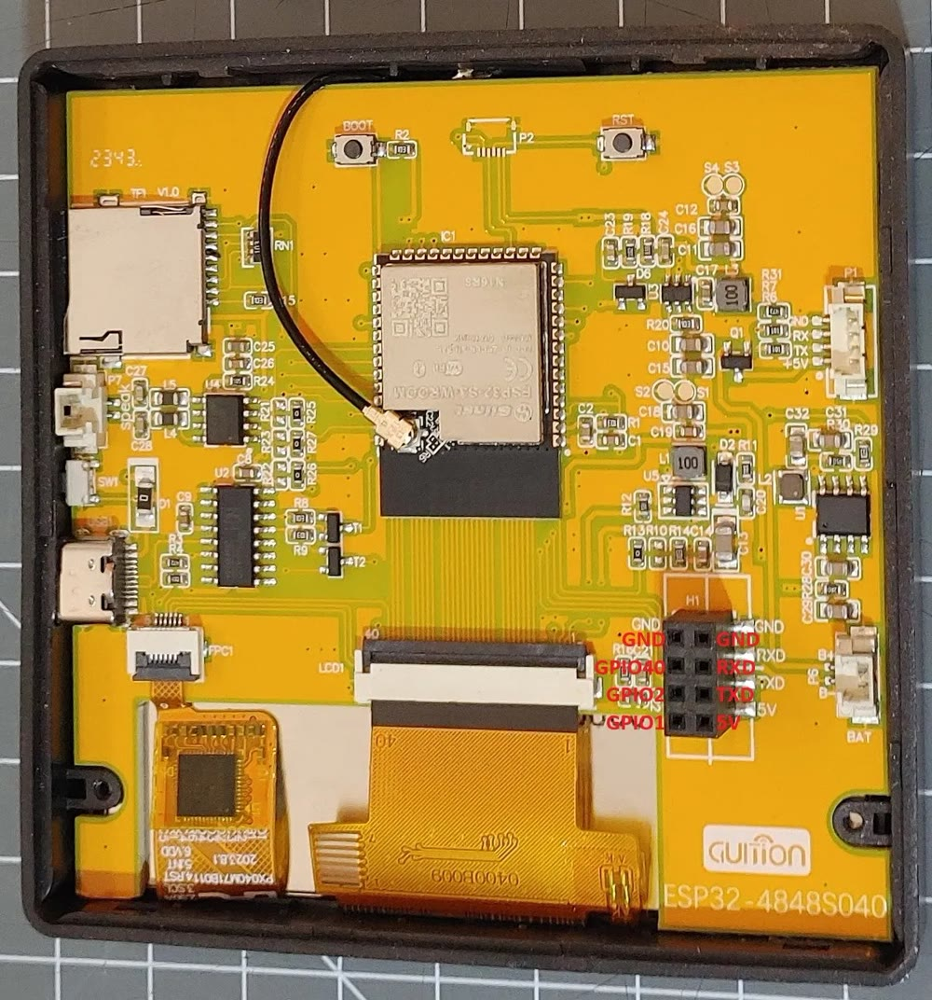
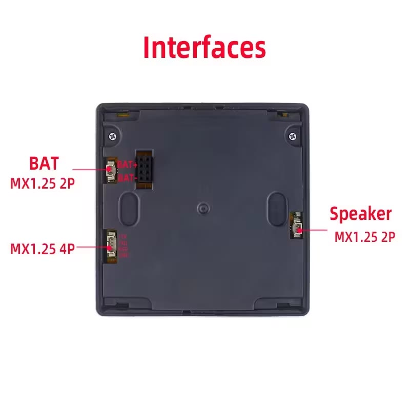

# NES para ESP32-S3 4848S040

Emulador de NES ([Nofrendo](components/nofrendo/AUTHORS)) sobre **ESP-IDF v6.1** para la placa
**Guition ESP32-4848S040**: pantalla táctil de 4" 480×480, microSD y bocina integrada.
Incluye controles táctiles en pantalla, **Zapper táctil** (Duck Hunt y similares) y audio por I2S.


> **No incluye ROMs ni apoya la piratería.** Este proyecto no contiene juegos y no se creó para copiarlos ni
> distribuirlos de forma ilegal. Usa solo copias de seguridad de cartuchos que poseas legítimamente. Nintendo y
> los demás titulares conservan todos sus derechos; ver el [aviso legal](#aviso-legal) al final.

## Hardware

| Componente | Detalle |
|---|---|
| Módulo | ESP32-S3-WROOM-1 (16 MB flash, 8 MB PSRAM octal) |
| Pantalla | ST7701, 480×480, bus RGB de 16 bits (RGB565) |
| Táctil | GT911, I2C, hasta 5 puntos |
| Almacenamiento | microSD (SDMMC, 1 bit) |
| Audio | amplificador I2S mono (NS4168 según [LCD Wizard](https://lcdwizard.com/boards/guition-4848s040-speaker); el chip no es legible en la foto) en el conector `P7 Speak` |

### Fotos de la placa

| Conectores internos (H1, P7 Speak, BAT, microSD) | Vista lateral (USB-C y ranura TF) | Vista trasera (interfaces) |
|---|---|---|
|  |  |  |

El conector de la bocina es un **MX1.25 de 2 pines** (`P7 Speak`). El conector `H1` expone `GPIO40`, `GPIO2` y
`GPIO1` (los pines de los relés y, según la configuración de resistencias, del audio), `RXD`, `TXD`, `5V` y `GND`.

Estas fotos son de terceros (fotos de producto del vendedor y una foto del conector con anotaciones). Pertenecen a
sus autores y se incluyen solo como referencia; sustitúyelas por fotos propias si vas a redistribuir el repositorio.

### Pines usados

| Función | GPIO |
|---|---|
| Retroiluminación | 38 |
| ST7701 (init por SPI de 3 hilos, por software) | CS 39, SCK 48, SDA 47 |
| Bus RGB | HSYNC 16, VSYNC 17, DE 18, PCLK 21, datos `4 5 6 7 15 8 20 3 46 9 10 11 12 13 14 0` |
| Táctil GT911 (I2C, dirección 0x5D) | SDA 19, SCL 45 |
| microSD (SDMMC, 1 bit) | CLK 48, CMD 47, D0 41 |
| Audio I2S | BCLK 1, LRCLK 2, DIN 40 |
| Consola serie (UART0, conector `P1` y `H1`) | TX 43, RX 44 |
| Relés (solo versión con relés) | 40, 2 y 1: **comparten pines con el audio** |
| Batería | conector `BAT` MX1.25 de 2 pines, sin GPIO |

Notas sobre el uso de pines:

- **GPIO 47 y 48 se comparten:** el firmware los usa por software para inicializar el ST7701 al arrancar y después
  son CMD y CLK de la microSD. La inicialización de la pantalla termina antes de montar la tarjeta.
- **Pines de arranque (*strapping*) del ESP32-S3 en uso:** GPIO0, 3 y 46 llevan datos del bus RGB y GPIO45 es el
  SCL del táctil. Así funciona la placa de fábrica; no los reasignes sin comprobar el arranque.
- **GPIO 43 y 44** son la consola serie (`idf.py monitor`); no los uses para otra cosa si quieres ver los logs.
- La búsqueda de D0 de la tarjeta prueba además 42, 40, 2, 1 y 39 si el 41 falla, pero omite los pines del audio.

Los pines de audio (1, 2 y 40) son los mismos que usan los relés de la versión con relés. Según
[LCD Wizard](https://lcdwizard.com/boards/guition-4848s040-speaker), tres resistencias de 0 Ω junto al
amplificador deciden a cuál van: **R21, R22, R23** a la bocina o **R25, R26, R27** a los relés. Si tu placa
trae las resistencias en R25–R27, no sonará hasta que las muevas a R21–R23. No lo he verificado en todas
las revisiones de la placa.

## Compilar y grabar

Requisitos: ESP-IDF v6.1 instalado y exportado en la terminal.

```powershell
idf.py set-target esp32s3        # solo la primera vez
idf.py build
idf.py -p COM12 flash            # ajusta el puerto
idf.py -p COM12 monitor
```

`idf.py flash` graba también `rom/game.nes` en la partición `nesgame` (0x110000). Esa ROM no está en el
repositorio: pon la tuya en `rom/game.nes` antes de grabar, o usa la microSD (ver más abajo).

Si `idf.py` se queja de que el directorio `build/` se configuró con otro entorno de Python, compila en otro
directorio con `idf.py -B <carpeta> build`, o borra `build/`.

### Particiones (`partitions.csv`)

| Nombre | Tipo | Offset | Tamaño |
|---|---|---|---|
| nvs | data | 0x9000 | 24 KB |
| phy_init | data | 0xf000 | 4 KB |
| factory | app | 0x10000 | 1 MB |
| nesgame | 0x40 / 0x01 | 0x110000 | 1 MB (ROM, máximo 1 MB) |

## Uso

### Elegir juego (microSD)

Si hay tarjeta, al arrancar aparece el menú **ELIGE UN JUEGO** con los `.nes` de `/`, `/nes` y `/roms`.
Toca un juego (o `JUGAR`) y se copia a la partición `nesgame`; si ya estaba grabado igual, no se vuelve a
escribir. Sin tarjeta o sin archivos `.nes`, arranca el juego que ya está en la flash.

| Botón del menú | Acción |
|---|---|
| `<` / `>` | página anterior / siguiente |
| `ZAP:AUTO/SI/NO` | modo Zapper del juego seleccionado |
| `JUGAR` | copia la ROM y arranca |
| `CAL` (barra roja) | recalibrar el táctil |

Una **Z** verde junto al nombre indica que el juego usa el Zapper.

### Controles en el juego

Cruceta, `A`, `B`, `SELECT` y `START` en pantalla. Con un toque corto en `MENU` se reinicia y se vuelve a la
selección de juego.

| Combinación | Efecto |
|---|---|
| Start + Select + A + B | reinicio del juego |
| Select + Start (1 s) | reinicio del equipo |

### Calibración del táctil

Se calibra la primera vez con 4 cruces y se guarda en la memoria no volátil. Para repetirla, enciende la placa
con un dedo en la pantalla o usa `CAL` en el menú de juegos.

### Zapper táctil

Tocar el área de juego equivale a disparar la pistola en ese punto.

- **Por juego:** `AUTO` lo activa por el nombre del archivo (Duck Hunt, Hogan's Alley, Wild Gunman, Gumshoe,
  Operation Wolf…). Si no lo detecta, pon `ZAP:SI`. Se guarda por juego.
- **Gatillo:** se pulsa 6 cuadros por toque.
- **Sensor de luz:** sigue apuntando al punto tocado ~0.75 s y solo ve luz casi blanca (luminancia ≥ 220) en un
  radio de 10 px NES. Duck Hunt decide el acierto con un cuadro negro y otro con cajas blancas, unos 10 cuadros
  después del toque.
- **Mira roja:** se dibuja donde el sistema cree que disparaste.
- Constantes ajustables en `main/video_audio.c` (`ZAP_*`).

### Audio

I2S a 22 050 Hz, el canal se duplica a estéreo. El emulador deja las muestras en un anillo y una tarea propia
las manda al I2S. El volumen se ajusta en `idf.py menuconfig` → *NES ESP32-S3 – Audio* (`AUDIO_VOLUME`, 0–400 %).

## Arquitectura

```
main/
  main.c          arranque, calibración, menú, copia de la ROM a PSRAM
  menu.c          menú táctil de ROMs desde la microSD
  gamepad.c       táctil GT911, botones en pantalla y calibración
  lcd_rgb.c       ST7701 + bus RGB, triple buffer y dibujo del juego
  ui.c            controles dibujados en el lienzo de la interfaz
  video_audio.c   capa OSD de Nofrendo: video, audio, entrada, Zapper
  zapper.c        modo Zapper por juego (detección por nombre, NVS)
components/nofrendo/   emulador (código de 2001, modificado)
```

- **Núcleos:** el emulador corre solo en el núcleo 1. Panel, vídeo, audio y táctil corren en el núcleo 0
  (el táctil con prioridad 7 para que el vídeo no lo deje sin CPU).
- **Vídeo:** el emulador copia cada cuadro (256×240) a un búfer privado; el hilo de vídeo siempre toma el más
  reciente, lo escala 1.5× (se recortan 8 columnas por lado, como el overscan de una tele: imagen de 360×288)
  y lo escribe en uno de **tres framebuffers** en PSRAM. El panel cambia de búfer al inicio de cada cuadro,
  sin *tearing*. Reloj de píxel de 16 MHz (`LCD_PCLK_HZ` en `lcd_rgb.c`).
- **Entrada:** se lee justo antes de emular cada cuadro.
- **Reloj del emulador:** `esp_timer` a 60 Hz exactos.

## Rendimiento y limitaciones conocidas

- El emulador va cerca de 60 cuadros/s, pero **la pantalla puede bajar a 22–45 fps** en cuadros pesados, porque la
  conversión del cuadro y la interrupción del panel comparten el núcleo 0.
- El panel usa *bounce buffer*: una interrupción copia ~28 MB/s con la CPU. Probé quitarlo y la imagen se
  corrompió en esta placa, así que no se usa.
- Cada 5 s el monitor serie muestra cuadros/s del emulador, fps en pantalla, tiempo de dibujo y audio perdido.
- Super Mario Bros 3 (mapper MMC3) y el scroll rápido son los casos más exigentes.
- Mappers soportados: los de Nofrendo (0–5, 7–9, 11, 15, 16, 18, 19, 24, 32–34, 40–42, 46, 50, 64–66, 70, 73,
  75, 78, 79, 85, 87, 93, 94, 99, 160, 229, 231 y VRC).
- Escribir en la flash (copiar una ROM de la SD) puede interrumpir la imagen unos instantes.

## Base del emulador y enlaces

- **Emulador original: Nofrendo**, de Matthew Conte (© 1998–2000). No encontré un repositorio oficial del
  autor; el desarrollo original está documentado en esta
  [página de historia del emulador](https://lngn.net/archaic-ruins/emulator/nes/nofrendo.htm).
- **Port a ESP32 en el que se basa `components/nofrendo`:**
  [espressif/esp32-nesemu](https://github.com/espressif/esp32-nesemu), una prueba de concepto de Espressif que
  adapta Nofrendo como componente de ESP-IDF. Según su documentación no incluye sonido y no recibe más
  desarrollo. Hay más contexto en el
  [hilo del foro de esp32.com](https://esp32.com/viewtopic.php?p=3965).
  El archivo [`components/nofrendo/AUTHORS`](components/nofrendo/AUTHORS) atribuye esa adaptación a
  Jeroen Domburg (Espressif).
- No he comparado este código línea por línea con el de Espressif; la relación se deduce del `AUTHORS` y de los
  comentarios del propio código.

### Qué se añadió o cambió respecto a esa base

- Salida de **audio I2S** hacia la bocina de la placa, en una tarea propia.
- **Pantalla** ST7701 480×480 con triple búfer, imagen recortada 360×288 y controles táctiles en pantalla.
- **Táctil** GT911 con calibración, **Zapper táctil** y modo Zapper por juego.
- **Menú de ROMs** desde la microSD, con copia a la partición `nesgame`.
- Reloj del emulador a 60 Hz exactos, copia de cada cuadro, ROM en PSRAM y reparto del trabajo entre los dos
  núcleos.

## Aviso legal

- **Sin afiliación:** este es un proyecto personal y educativo (curso Arquitectura II, UMG). **No está afiliado,
  patrocinado, autorizado ni respaldado por Nintendo** ni por ningún otro fabricante o editor de videojuegos.
- **Marcas y derechos de terceros:** *Nintendo*, *Nintendo Entertainment System*, *NES*, *Famicom*, *Zapper*,
  *Super Mario Bros.*, *Duck Hunt*, *Hogan's Alley*, *Wild Gunman* y los demás nombres, personajes, imágenes y
  juegos que se mencionan o aparecen en capturas son marcas registradas y obras protegidas por derechos de autor
  de **Nintendo** o de sus respectivos titulares. **Todos los derechos reservados a sus propietarios.** Se citan
  únicamente para identificar la consola y los juegos con los que es compatible el emulador.
- **Sin piratería:** no apoyamos, fomentamos ni toleramos la piratería de software de ninguna manera. El repositorio
  **no incluye ROMs, BIOS ni material con derechos de autor** y `.gitignore` excluye los archivos `*.nes`. No
  pidas ni compartas ROMs en los issues, pull requests ni en ningún otro lugar de este proyecto.
- **Uso responsable:** usa el emulador solo con copias de seguridad que hayas hecho tú mismo de cartuchos que posees
  legítimamente, o con juegos homebrew y de dominio público. Las leyes sobre copias de seguridad cambian según el
  país; cumplir con la ley de tu jurisdicción es tu responsabilidad. Esto no es asesoría legal.
- **Capturas e imágenes:** `docs/ejemplo-*.jpg` y `docs/dispositivo.jpg` muestran un juego comercial en pantalla
  solo como ilustración del funcionamiento. Las fotos de la placa son de terceros (ver la sección de hardware).
- **Sin garantía:** el software se ofrece "tal cual", sin garantía de ningún tipo, bajo los términos de la licencia.
- **Retirada de contenido:** si eres titular de derechos y consideras que algún contenido de este repositorio
  infringe tus derechos, abre un issue y se retirará.

## Licencia

Todo el repositorio se distribuye bajo la **GNU Library General Public License, versión 2** (LGPL 2.0), la misma
licencia del emulador. El texto completo está en [`LICENSE`](LICENSE).

- **Nofrendo** © 1998–2000 Matthew Conte: sus cabeceras de código lo licencian bajo esa licencia ("version 2 of the
  GNU Library General Public License") y exigen conservar la leyenda en toda reproducción. Mis modificaciones a los
  archivos de `components/nofrendo/` quedan bajo la misma licencia.
- **Código propio** (`main/`, etc.): © 2026 los autores de este repositorio, bajo la misma licencia.
- **Discrepancia a tener en cuenta:** el README de Espressif describe el componente Nofrendo como GPLv2, mientras
  que las cabeceras dicen "Library" GPL. Elegí la de las cabeceras. La LGPL 2.0 permite además pasar a la GPL
  (sección 3), así que cambiar a GPLv2 sería compatible si más adelante lo prefieres.
- Si reutilizas código del repositorio de Espressif que esté fuera de Nofrendo, su README lo indica bajo
  Apache License 2.0. No he comprobado si este repositorio contiene alguno.
- La captura de `docs/dispositivo.jpg` muestra un juego comercial en pantalla; el repositorio no incluye ROMs.
